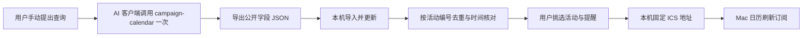

# 麦当劳 MCP 接入说明

## 实际使用的能力

- Server：`https://mcp.mcd.cn`，传输为 Streamable HTTP。
- Tool：`campaign-calendar`（只读活动日历）。本项目已验证的两次真实查询均使用空参数 `{}`，查询当月活动。
- 使用方式：开发者在已配置个人凭证的 AI 客户端中，明确要求手动查询一次。Node 服务不连接 MCP，不读取 Token，不领取优惠券或创建订单。

接口说明来源：[官方 MCP 文档](https://github.com/M-China/mcd-mcp-server)。查询内容可能只覆盖部分日期；它不是未来所有活动完整、提前公布时间的保证。

## 调用流程与业务价值



将预热信息转换为可选择、可更新的个人日程。展示日期与真实开售时刻分开，避免把重复宣传当成新活动；更新保留用户选择，不把全部宣传自动塞进日历。

## 导出公开字段快照

在已配置 MCP 的客户端中，可使用以下请求：

> 请手动调用一次麦当劳 campaign-calendar，查询当月活动。只导出以下公开字段为麦日历 JSON：每日 date、events 中的 activityCode、articleDto.title、articleDto.content、button.text 和 button.subText。按相同编号与相同文案合并展示日期，文案不同时保留两条，不改写官方正文，不猜开售时间。source.mode 写 real，service 写 麦当劳中国官方 MCP，tool 写 campaign-calendar，queriedAt 用本次返回的查询时间（北京时间）；如返回未给查询时间，记录实际调用时间。不要导出原始完整响应、Token、会员信息、traceId 或其他元数据。

结构如下。下列内容是**字段格式演示，不是真实查询结果**，请替换成此次实际查询值：

```json
{
  "source": {
    "mode": "real",
    "service": "麦当劳中国官方 MCP",
    "tool": "campaign-calendar",
    "arguments": {},
    "queriedAt": "2026-10-13 09:10:40"
  },
  "items": [
    {
      "activityCode": "example-id",
      "title": "示例标题",
      "content": "这里保留实际查询得到的原文，不补写时间。",
      "displayDates": ["2026-10-15"],
      "buttonText": "按钮文案",
      "buttonTimeText": "提醒按钮的 subText"
    }
  ]
}
```

`buttonTimeText` 来自 **button.subText**，不是 activitySubTitle。日期用 `YYYY-MM-DD`，查询时间用 `YYYY-MM-DD HH:mm:ss`（北京时间）。最多 300 条、每条正文最多 20,000 字符，整体导入不超过 2 MiB；额外字段不保存。为保持已选活动，后续查询应保持相同实际活动编号。

导入保存待更新文件；点击“更新活动”才替换当前快照。旧格式没有 mode 时按 real 处理，兼容已验证的本地概念稿。新用户默认 demo，须先取消演示选择才能导入真实活动。

## 实际调用与体验证据

2026-10-13（北京时间）的两次真实手动查询：

| 查询时间 | 观察与处理 |
|---|---|
| 08:10:56 | 13 个日期组、27 条展示记录，经活动编号与文案合并为 16 项内容；只有 2 项未来活动有可核对的正式开售日期和时刻。此数量不代表 16 场独立活动，也不代表完整月度覆盖。 |
| 09:10:40 | 与第一次内容一致；用户应用新快照后原徽章选择保留，Mac 日历手动刷新后备注中显示本次查询时间。 |

开发阶段另在隔离的原生 Mac 订阅中，用标注虚构的快照模拟改期，验证同 UID 的日程移动且不重复。真实查询没有发生改期，不把模拟当成官方变更。

公开仓库不保存这两份完整真实快照或原始响应。以上为开发记录与用户实际试用反馈；自动测试使用构造数据，默认网页使用虚构数据。主办方仍可要求进一步核验，材料齐全不代表已经通过资格审核。

## 配置与安全边界

[mcp-config.example.json](mcp-config.example.json) 只有环境变量占位符。具体客户端须支持环境变量展开；不支持的客户端应在自己的私有配置中按其官方说明配置凭证，不能把真实值填回仓库中的示例，也不能粘贴到 AI 对话。客户端若支持工具限制，仅启用 campaign-calendar。

[官方服务规则](https://cdn.mcd.cn/cms/pages/MCPServerRules.html) 限定个人正常使用，禁止自动化调用及凭证分享或未经认证的第三方托管。因此项目和 CI 均不调用 MCP，Mac 自动刷新只读取本机生成的 ICS，不触发官方查询。查询失败时保留旧数据，不自动重试；缺席不推断取消，冲突不生成新提醒。

## 本机接口

所有写入都要求 `127.0.0.1:端口` 的同源 JSON，限制请求大小，错误格式为 `{ "error": { "code": "...", "message": "..." } }`。

| 接口 | 输入与结果 |
|---|---|
| GET /api/state | 当前公开快照、selected、reminder、revision、preparedAt、lastUpdate。 |
| POST /api/preferences | `{selected, reminder, revision}`，保存选择；陈旧 revision 返回 409。 |
| POST /api/snapshots | `{snapshot, revision}`，校验来源模式、版本与字段，准备公开快照；不应用。 |
| POST /api/demo-updates | `{revision}`，仅在 demo 模式准备虚构徽章改期；real 模式返回 409。 |
| POST /api/updates | `{revision}`，应用待更新快照并保留同模式已选活动。 |
| GET /calendar.ics | 当前已选日程，支持 ETag 和 304。 |

仅公开页面资产，状态文件、待更新文件与服务源码不能通过 HTTP 下载。数据按原子写入保存；来源模式切换时已有选择必须由用户先取消。
