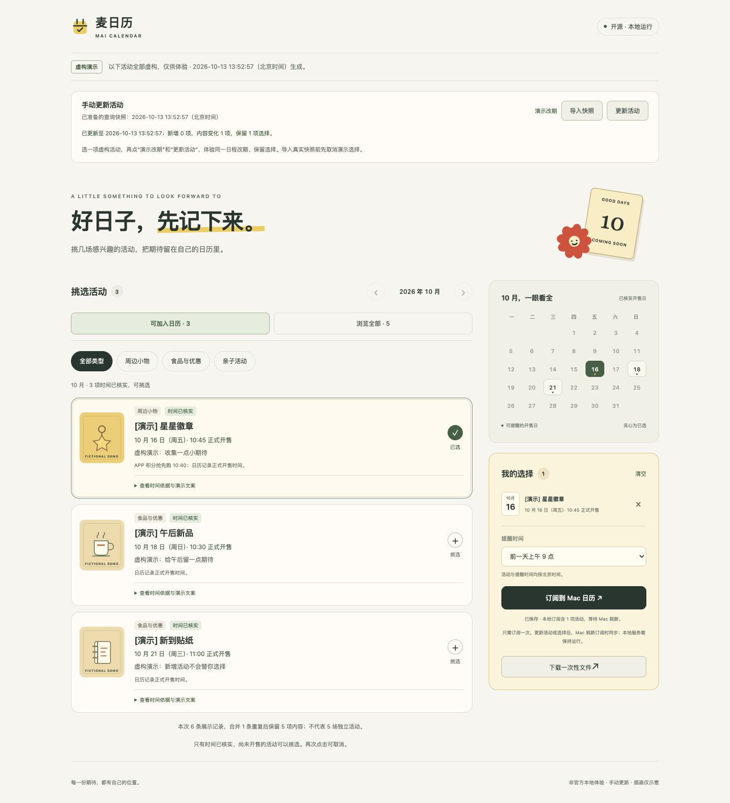

# 麦日历 · Mai Calendar

把感兴趣的活动放进自己的日历：**手动查询活动 → 核对时间 → 挑选 → 订阅到 Mac 日历 → 更新时保留选择**。

面向使用 Mac、关注新品或周边发售，并愿意在本机运行小工具的用户。麦日历是非官方开源项目；首次运行使用明确标注的虚构活动，不需要 Token。真实活动由你在已配置麦当劳 MCP 的 AI 客户端中手动查询，项目不会后台取数。



## 三分钟体验

需要 [Node.js](https://nodejs.org/zh-cn/download) 22 或以上版本（本机验证为 24）。在终端执行：

```sh
git clone https://github.com/jinke000001/mai-calendar.git
cd mai-calendar
npm start
```

没有运行时第三方依赖，无需 `npm install`。打开 **http://127.0.0.1:3268**，保留终端窗口；按 Control+C 停止。Mac 也可双击 `启动麦日历.command`。服务只监听本机，不向外部发送活动或选择。

1. 选择 `[演示] 星星徽章`，设置需要的提醒，等页面显示“已保存”。
2. 点击“订阅到 Mac 日历”并复制地址；在 Mac 日历的 **文件 → 新建日历订阅** 中粘贴。位置选择 **Mac**，自动刷新可选每天或每15分钟。需要提醒时取消“移除”下的“提醒”，并保持“忽略提醒”不勾选。本机 HTTP 地址可能显示不安全连接提示，地址只指向 `127.0.0.1`。
3. 点击页面的“演示改期”，再点击“更新活动”；徽章仍然选中。Mac 日历按 **⌘R**（显示 → 刷新日历）后，同一演示徽章移到后一天；新增贴纸不会自动选中。全部演示内容虚构，不代表官方改期。

也可以下载一次性 `.ics` 文件。一次性导入不随更新变化，旧导入与新订阅不会自动合并；建议把演示放在单独的日历中，方便管理。

## 使用真实活动

先在自己的 AI 客户端配置 [官方麦当劳 MCP](https://github.com/M-China/mcd-mcp-server)。凭证只放在客户端的私有配置中，**不要粘贴到对话、网页、仓库或 GitHub Secrets**。本项目不读取或保存 Token。

1. 在客户端明确要求手动调用一次 `campaign-calendar`，按 [MCP_INTEGRATION.md](MCP_INTEGRATION.md#导出公开字段快照) 导出公开活动字段的 JSON。
2. 先取消已有的演示选择，然后点击麦日历的“导入快照”，选择该 JSON 文件；检查准备好的查询时间，再点击“更新活动”。
3. 挑选时间完整的活动。以后重新查询、导入、更新即可保留真实活动的选择与提醒；Mac 日历刷新订阅时同步。

页面的“已保存”表示本地保存成功；Mac 是否读取了新内容，可以双击日程查看备注中的**来源查询时间**。没有内容变化时，日程日期不会改变。

熟悉终端的用户也可准备快照：

```sh
npm run snapshot:prepare -- /absolute/path/to/snapshot.json
```

随后仍需点击页面“更新活动”。原始 MCP 响应不作为导入格式；只接受说明中列出的公开字段。导入上限为 2 MiB，写入前会校验并去除额外元数据。

## 更新规则

- 同一活动编号的重复展示合并；同编号文案冲突保留浏览，等待核实。展示日期不会被当成开售日期。
- 正文必须有明确的开售日期和时刻，并与提醒按钮的时间一致；优惠日期范围、未公布的预约场次不能直接生成提醒。跨月省略年份时不猜年份。
- 改期使用同一 UID、递增 SEQUENCE；只同步已选活动。未出现在本次快照的已选活动保留上次核实日程并注明等待复核；新文案有时间冲突时保留选择，暂停该项订阅。
- 已开始的已选日程保留历史。旧快照、损坏文件、空快照、陈旧页面的覆盖请求会被拒绝；演示与真实数据切换前须取消选择。

实际参与条件、价格、时间变化及供应情况以官方渠道为准。规则检查核对的是导入文案的日期和字段，无法认证文件的来源，也不能保证活动不会变化。

## 本地运行与排查

- 默认订阅地址：`http://127.0.0.1:3268/calendar.ics`，仅供当前 Mac 使用。关闭服务、电脑关机或项目所在硬盘断开时不能刷新；日历已有内容通常仍保留。
- 选择和提醒保存在 `.local-calendar/state.json`；待应用快照在 `output/manual-updates/latest.json`。两者都不进入 Git。重新运行会恢复保存的数据。
- 端口被占用：关闭已运行的同一服务，或设置 `MAI_CALENDAR_PORT` 后启动。使用其他端口时需要订阅该端口的地址。
- 保存文件损坏：停止服务，备份 `.local-calendar`，保留原文件后排查；程序不会静默清空。不要用删除目录作为常规更新步骤。
- 可设置 `MAI_CALENDAR_DATA_DIR` 为仓库之外的独立目录；此时状态与待更新文件都存入该目录。便于在另一端口演示而不影响已有订阅。
- 直接打开 `index.html` 可以体验虚构活动和一次性下载；订阅与快照导入需要 `npm start`。

## 开发与验证

```sh
npm ci --ignore-scripts
npm run check
npm test
npm audit --omit=dev
```

Node 内置 HTTP 服务与测试工具，HTML/CSS/JavaScript 前端。GitHub Actions 仅执行离线代码检查，**不调用 MCP**。自动检查覆盖去重、时间冲突、稳定 UID、改期、选择保留、来源切换、快照导入、重启恢复、访问限制和失败保留。

验证记录（2026-10-13）：

- 真实 MCP 手动查询两次，查询时间 `08:10:56` 与 `09:10:40`（北京时间）。用户更新后已选徽章保留，Mac 日历手动刷新后，备注查询时间为 `2026-10-13 09:10:40`。两次真实活动内容未变，不作为真实改期的证据。
- 此前在独立原生 Mac 测试订阅中，用明确标注的虚构改期验证同 UID 移动且无重复；测试订阅已移除。
- 本版 28 项 Node 检查与 29 项 Chrome 页面流程检查通过；实际下载和订阅响应经独立 `ical.js` 解析核对。320/768/1024/1440px 无横向溢出；在保留相同 CSP 的只读隔离检查页面，四种宽度的 axe 检查无 WCAG 2 A/AA、2.1 AA 规则违规。
- 公开仓库实际重新克隆后，安装、语法检查、28 项 Node 检查与启动通过；依赖审计为 0 漏洞。[首轮 GitHub Actions](https://github.com/jinke000001/mai-calendar/actions/runs/38355602689) 的 Linux/macOS/Windows × Node 22/24 共 6 个任务全部成功。云端检查为代码与接口验证，不等同于这些系统的原生日历体验。
- 原生 Safari、真实 Windows 日历、手机、每天自动刷新的实际等待和提醒实际触发尚未验证。网页窄屏检查不等同于手机实测。

## 参赛与开源

本项目基于真实使用的 `campaign-calendar` 能力。参赛文件为本 README、[官方原文参赛声明](CONTEST_DECLARATION.md)、[MCP 接入说明](MCP_INTEGRATION.md)、[环境变量配置示例](mcp-config.example.json)。报名内容已准备在 [CONTEST_SUBMISSION.md](CONTEST_SUBMISSION.md)，正式报名状态以主办方回复为准。

遵循 [MCP 服务规则](https://cdn.mcd.cn/cms/pages/MCPServerRules.html)：由用户手动触发个人正常查询，项目没有脚本取数、定时轮询或第三方 Token 托管。真实活动数据留在使用者本机；公开仓库仅提供代码、虚构演示和构造测试输入。

源代码和原创演示素材采用 [MIT License](LICENSE)。商标、官方数据及官方参赛声明的权利说明见 [NOTICE.md](NOTICE.md)。这份协议不会赋予麦当劳数据或商标的使用权。
